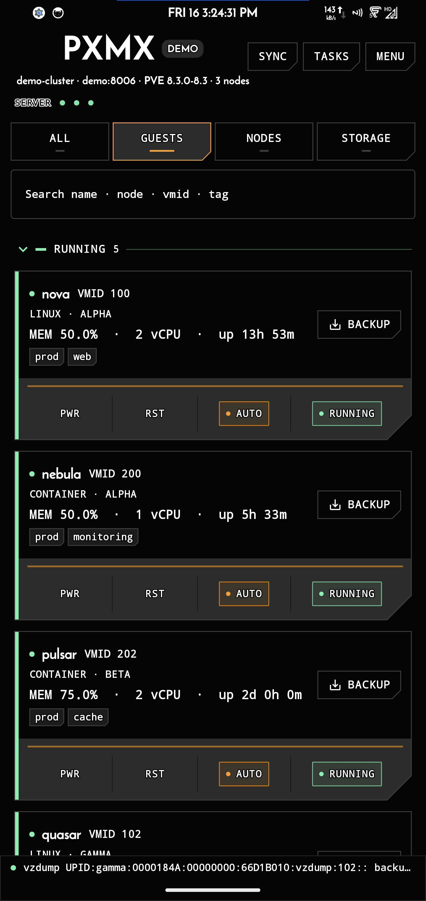
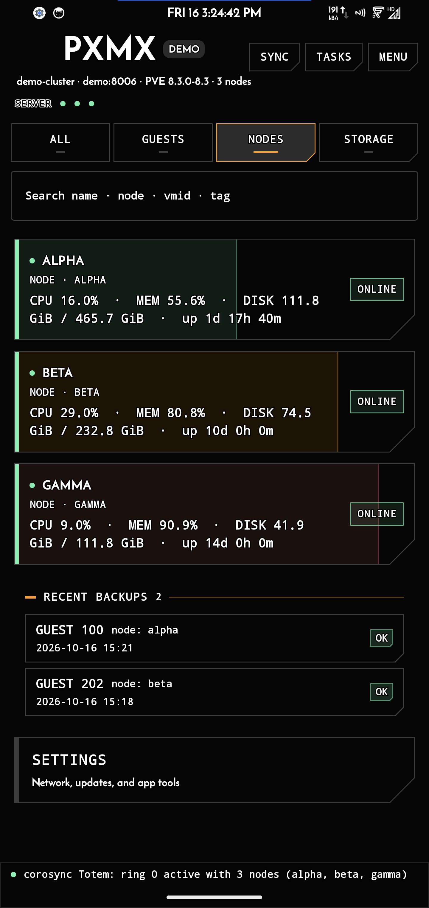
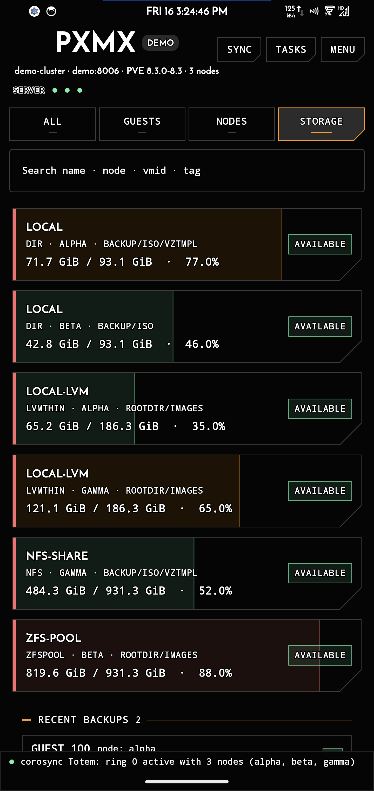
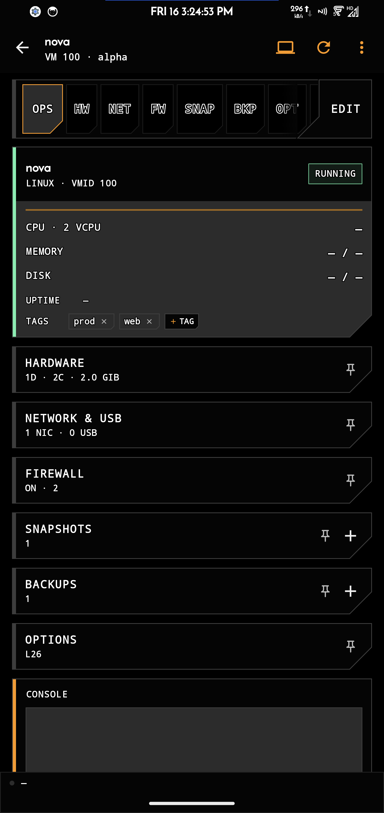
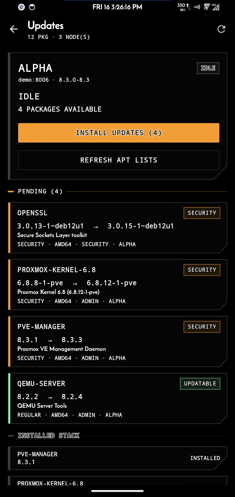
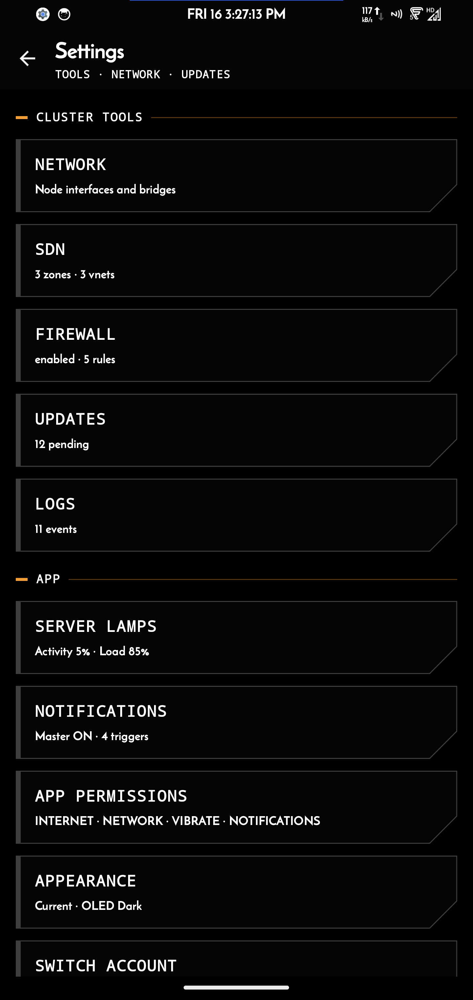

# PXMX

*An Android client for Proxmox VE.*

 

PXMX puts your Proxmox VE cluster in your pocket. It talks straight to your
servers over TLS, from a phone-sized interface: check nodes and guests, start
and stop machines, deploy from a template, back up, update, and open a console
when a host needs hands-on attention.

**Connect**

| Area | What you get |
| --- | --- |
| Sign in | Password, API token, or TOTP two-factor. With "Trust self-signed" on, the first connection pins the server's certificate; if it ever changes, the app refuses rather than silently re-accepts. |
| Saved servers | One profile per server. Only the host and username are stored; passwords and tokens live in encrypted storage keyed by the Android Keystore. Hosts that belong to the same cluster group together after you sign in. |
| Network discovery | Scan the local network for Proxmox hosts. A sweep runs while it works. Results come back as verified, needs your login, or unknown. Tap a verified row to prefill host and port. Ping a found host to see latency as a fill on the row. |
| Server check | Test a saved server at any time: online state, version, and latency. |
| All servers | One screen that probes every saved host and shows what is up. |
| Open in browser | Jump from any screen to the matching page in the web UI. |

**Day to day**

| Area | What you get |
| --- | --- |
| Home | Guests, nodes, and storage at a glance. A SERVER lamp strip shows each node. Newest cluster events stay pinned below. |
| Nodes | Per-node status: CPU, memory, and disk fills, hour or day history, plus confirmed reboot or shutdown of the hypervisor. |
| Storage | Usage fills across all your datastores. On a store that accepts ISO images, upload an ISO from the system file picker. The picker is the file manager; there is no all-files grant. |
| Guests | Power actions (start, stop, reboot, suspend, resume, reset), auto-start, hour or day history, and a guest detail board. Names sit next to a status lamp, in readable type. |
| Guest board | OPS is the home plate. A mill-cut bezel jumps to HARDWARE, NETWORK, FIREWALL, SNAPSHOTS, BACKUPS, OPTIONS, and RAW. Network plates show live IPs, addressing, NIC firewall and link toggles. |
| Backups | Start and delete backups from the guest. Download a backup to the phone when the cluster allows it. |
| Updates | Refresh package lists and apply updates with a live, step-by-step progress view. On Proxmox VE 9, where the API no longer allows remote installs, the app walks you to the node shell command instead. |
| Console | noVNC for QEMU and LXC guests, and an xterm.js node shell for the host. API tokens can open QEMU and LXC consoles; the node shell requires a ticket (password) login. |
| Firewall and SDN | Read-only views of cluster firewall rules and SDN zones and vnets. |
| Notifications | Optional alerts for backups, migrations, and related cluster tasks. Android 16 can promote long tasks as Live Updates. |

**The app itself**

| Area | What you get |
| --- | --- |
| First-run tour | A short walkthrough of the main screens the first time the app opens. |
| Demo mode | Five taps on the PXMX title at login loads a canned sample cluster. It is clearly labeled DEMO. No server and no network are required. A demo scan uses documentation-range addresses and is marked DEMO SIMULATION. |
| Clean slate | A deliberate, held-down wipe that removes everything the app has stored, for when the phone changes hands. |
| Look | Three modes: OLED Dark, Light, and follow System. OLED Dark is the default. Lists glow orange when you reach the end. The splash screen uses the PXMX mark. |

## Screenshots

Tap any shot for the full size. All of these are demo mode on a phone.

|  |  |  |
| --- | --- | --- |
| [](docs/screenshots/01-home.png) | [](docs/screenshots/02-nodes.png) | [](docs/screenshots/03-storage.png) |
| [](docs/screenshots/04-guest-detail.png) | [](docs/screenshots/05-updates.png) | [](docs/screenshots/06-settings.png) |

A wider walkthrough, including foldable two-pane, lives on the
[showcase](https://primary-null.github.io/PXMX-VE/).

## Get it

Download the latest APK from the
[Releases](https://github.com/primary-null/PXMX-VE/releases) page and install
it on your phone (allow installs from unknown sources; there is no store
involvement and no account to create). First run opens the login screen. Five
taps on the PXMX title load demo mode so you can look around before you point
it at a server.

## Build it yourself

Plain Android project. Clone it, open it in Android Studio, and press Run, or
build from the command line:

```
./gradlew :app:assembleDebug
```

## Privacy

- TLS everywhere. Self-signed hosts get their certificate pinned on first
  login, and a changed identity is refused, never silently re-accepted.
  CA-signed hosts use the system trust store.
- Passwords and API tokens are encrypted at rest with Google Tink AEAD and
  DataStore, keyed by the Android Keystore. EncryptedSharedPreferences is kept
  until that vault write succeeds. Session tickets live only in memory, never
  on disk.
- No accounts, no telemetry, no analytics, no cloud. The app talks only to
  the servers you add, and demo mode touches nothing at all.

## Permissions

INTERNET, ACCESS_NETWORK_STATE, and VIBRATE require no runtime prompt.
POST_NOTIFICATIONS is a runtime prompt on Android 13+, and
POST_PROMOTED_NOTIFICATIONS is used for Android 16 Live Updates.
ISO upload uses the system file picker for a single file (no all-files or READ_MEDIA permissions).

| Permission | Why |
| --- | --- |
| Internet | Reach your Proxmox servers. |
| Network state | Find hosts on your local network. |
| Vibrate | Haptic feedback for actions. |
| Post notifications | Task alerts and external guest events. |
| Post promoted notifications | Foreground progress via Android 16 Live Updates. |

Details are listed in the app under **Settings > App permissions**.

## License

GPL-3.0. See [LICENSE](LICENSE).
